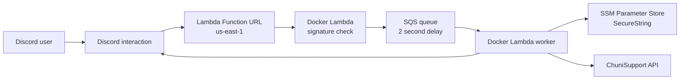

# 課題曲メーカー

Discord の `/kadai`、`/kadai-ex`、`/taikai` コマンドで CHUNITHM の課題曲を抽選する bot です。曲データには [ChuniSupport の Chunirec互換API](https://docs.chunisupport.net/api/compat-chunirec/) を使います。

## 現在の構成



Discord への応答時間を短くするため、受信Lambdaは署名を検証してキューへ処理を渡し、すぐに処理中の応答を返します。ワーカーLambdaがChuniSupportから曲を取得し、Discordの元の応答を更新します。

### AWSリソース

- CDK stack: `KadaikyokumakerStack` (`us-east-1`)
- Discord endpoint: `https://balq5eqvnrm2ruom3sngz6mzfi0ucezr.lambda-url.us-east-1.on.aws/`
- 受信Lambda: Docker image、Python 3.11、10秒 timeout
- SQS: 2秒遅延、暗号化有効、1日保持
- 結果返却Lambda: Docker image、Python 3.11、60秒 timeout
- ChuniSupport APIキー: SSM Parameter Store の SecureString `/kadaikyokumaker/chunisupport-api-key`

Lambdaの実行ロールは、このパラメーターの読み取りと対応するKMS復号だけを許可しています。APIキーやDiscord Bot Tokenをソースへ書かないでください。

### 古いAWSリソース

`ap-southeast-2` に HTTP API `makekadaikyoku` と、Python 3.13 の ZIP Lambda `makeKadaikyoku` が残っています。これはDiscord Developer Portalに登録されたFunction URLとは別系統で、現在のCDK stackでも管理していません。現在の `/kadai` の処理先ではありません。整理するまでは削除しないでください。

## コマンド

`/kadai` は下限・上限と曲数を指定します。3コマンドの下限・上限欄と、`/kadai-ex`・`/taikai` の対象欄では、整数（例: `14`）または `+` 表記（例: `14+`）を表示レベルとして、小数（例: `14.0`）を譜面定数として扱います。たとえば対象に `14` と入れると表示レベル14の譜面、`14.0` と入れると譜面定数14.0の譜面が対象です。条件の結果表示でも「レベル」「譜面定数」を区別します。

`/kadai-ex` は1〜20曲を選び、実行後に開くフォームでレベルまたは譜面定数、ジャンル、譜面難易度を絞り込めます。ジャンルは `POPS&ANIME`, `niconico`, `東方Project`, `VARIETY`, `イロドリミドリ`, `ゲキマイ`, `ORIGINAL`、譜面難易度は `BASIC`, `ADVANCED`, `EXPERT`, `MASTER`, `ULTIMA` から複数選べます。どちらも未選択なら全項目が対象です。対象欄では `13, 14+, 14.0` のようにレベルと定数を複数指定できます。同じ欄の項目はどれかに一致、異なる欄同士はすべてに一致する曲が対象です。各フィルターと上下限は省略できます。

`/taikai` は同じフィルターで候補から重複なしで最大10曲を選び、「選曲プール」として先に表示します。10曲に満たない場合は該当曲をすべてプールに採用し、プール表示から5秒後に実際の曲数に合わせた1D抽選（例：7曲なら1D7）を行い、結果を続けて表示します。候補が0曲の場合は抽選しません。`/kadai` と `/kadai-ex` も指定数に満たない場合は、取得できた曲をすべて表示します。

ジャンルと譜面難易度はフォーム内のチェックボックスで複数選択できます。対象レベル・定数の複数指定はカンマ区切りで入力します。譜面情報が存在しない難易度（例: `ULT` 欠損）は候補から除きます。譜面定数が未確定の譜面は、譜面定数を使った条件には一致しません。

結果はDiscordの埋め込み形式で表示し、曲名・アーティスト・譜面難易度・表示レベル・譜面定数を曲ごとにまとめます。譜面定数が未確定の場合は `未確定` と表示します。

既存のDiscordコマンド定義を更新するときは、`python -m pip install -r commands/requirements.txt` を実行し、`DISCORD_BOT_TOKEN` を環境変数として設定してから `python commands/register_commands.py` を実行します。コマンド定義の変更はAWSへのデプロイとは別作業です。

## ビルドとデプロイ

必要なもの: Node.js/npm、Docker Desktop、AWS CLI認証、CDK bootstrap済みのAWSアカウント。

```powershell
npm ci
npm run build
$env:CDK_DEFAULT_ACCOUNT = aws sts get-caller-identity --query Account --output text
$env:AWS_DEFAULT_REGION = "us-east-1"
npx cdk diff KadaikyokumakerStack --no-change-set
npx cdk deploy KadaikyokumakerStack
```

スタックのリージョンは `bin/kadaikyokumaker.ts` で `us-east-1` に固定しています。CDK diffを確認してからデプロイしてください。

## ローカルファイル

- `bin/`, `lib/`: CDKアプリとAWSリソース定義
- `src/app/main.py`: Discord署名検証、キュー送信、曲選択、結果返却
- `src/Dockerfile`, `src/requirements.txt`: Lambdaコンテナ
- `commands/`: Discord slash command定義と登録スクリプト

## 状態と確認

2026-10-19 にAWSへデプロイ済みです。既存Function URLは維持されています。ローカルのPython構文確認、TypeScript build、Linux/amd64コンテナbuild、およびFunction URLが未署名リクエストを401で拒否することを確認しました。

デプロイ後、ユーザーがDiscordで `/kadai` を実行し、曲が返ることを確認済みです。AWS側でも処理後のSQSキューが空で、受信Lambdaの直近エラーは0件でした。

2026-10-19 に結果表示を改善し、レベルを `15+` の表記で表示するDiscord embed形式をデプロイしました。各曲に譜面定数も併記し、APIで未確定の場合はその旨を表示します。新しい表示のDiscord上での再確認はこれからです。

`/kadai-ex` と `/taikai` の処理および複数選択フォームは2026-10-19にAWSへデプロイ済みで、同日にDiscordグローバルコマンドへ登録済みです。Discord上でフォーム選択と抽選を行うend-to-end確認は未実施です。

2026-10-19 に曲数不足時の部分結果対応と `/taikai` の5秒待機をAWSへデプロイし、Stack `UPDATE_COMPLETE` と両Lambdaの `LastUpdateStatus=Successful` を確認しました。Discordで10曲未満のプールと抽選を実行する確認は未実施です。

2026-10-19 に各レベル欄で整数・`+` を表示レベル、小数を譜面定数として扱う機能をAWSへデプロイし、Stack `UPDATE_COMPLETE` と両Lambdaの `LastUpdateStatus=Successful` を確認しました。Discordグローバルコマンドも再登録済みで、譜面定数入力はユーザーがDiscord上で動作確認済みです。

公開リポジトリ: [itan2929/kadaikyokumaker](https://github.com/itan2929/kadaikyokumaker)。ソースは `main` ブランチで管理しています。
